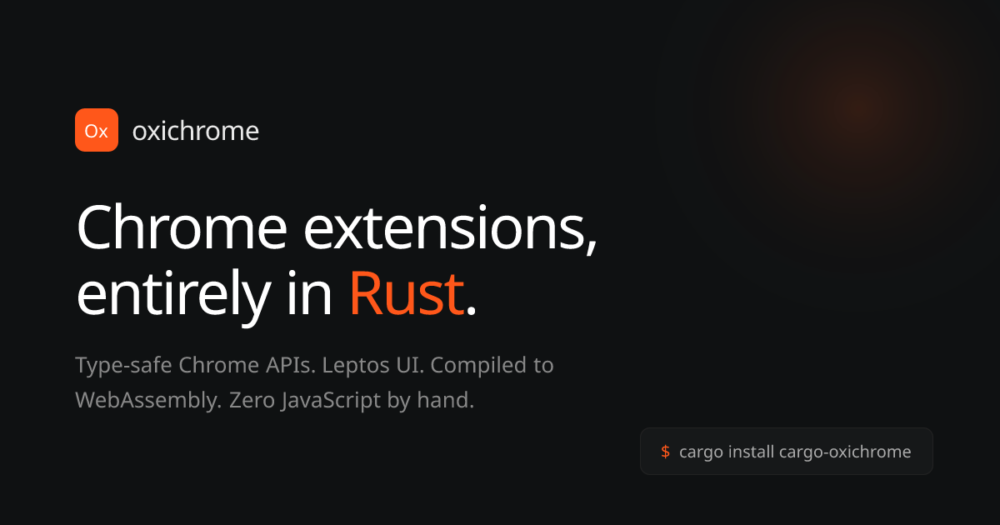

# oxichrome

[](LICENSE)
[](https://www.rust-lang.org)
[](https://developer.chrome.com/docs/extensions/develop/migrate/what-is-mv3)
[](https://oxichrome.dev)



Write browser extensions entirely in Rust, compiled to WebAssembly. Chrome and Firefox.

---

```rust
use leptos::prelude::*;
use oxichrome::prelude::*;

#[oxichrome::extension(
    name = "My Extension",
    version = "1.0.0",
    permissions = [Storage]
)]
struct Extension;

#[oxichrome::background]
async fn start() {
    oxichrome::log!("Running!");
}

#[oxichrome::popup]
fn Popup() -> impl IntoView {
    view! { <p>"Hello from Rust."</p> }
}
```

```sh
cargo oxichrome build                  # Chrome/Edge/Brave
cargo oxichrome build --target firefox # Firefox
```

---

## What it does

- Proc macros (`#[extension]`, `#[background]`, `#[on]`, `#[popup]`, `#[options_page]`, `#[side_panel]`, `#[content_script]`, `#[menu]`, `#[submenu]`, `#[command]`) transform your Rust into wasm-bindgen exports
- Typed bindings to `chrome.storage`, `chrome.tabs`, `chrome.runtime`
- Leptos for reactive popup, options page and side panel UI
- `cargo oxichrome build` handles everything: compilation, wasm-bindgen, manifest generation, JS/HTML shim generation, static asset copying, optional wasm-opt
- **`--target firefox`** generates a Firefox-compatible Manifest V3 extension
- Separate `dist/chromium/` and `dist/firefox/` output directories

Zero JavaScript written by hand.

## Install

```sh
cargo install cargo-oxichrome
```

Requires:
- Rust (stable)
- `wasm32-unknown-unknown` target (auto-installed on first build)
- `wasm-bindgen-cli`: nothing to do. `cargo oxichrome build` uses the `wasm-bindgen` on your `PATH` when its version matches your `Cargo.lock` exactly. Otherwise it installs the matching version once into `~/.cache/oxichrome/wasm-bindgen-cli/<version>` (`%LOCALAPPDATA%\oxichrome` on Windows, or `OXICHROME_CACHE_DIR`), leaving your global install alone

## Quick start

```sh
cargo oxichrome new my-extension
cd my-extension
cargo oxichrome build
```

`cargo oxichrome new` scaffolds a project with the `oxichrome` crate already in `[dependencies]`:

```toml
[dependencies]
oxichrome = { version = "0.2" }
wasm-bindgen = "0.2"
serde = { version = "1", features = ["derive"] }
```

**Chrome/Edge:** Load `dist/chromium/` in `chrome://extensions` with "Load unpacked".

**Firefox:** Build with `--target firefox`, then load `dist/firefox/manifest.json` in `about:debugging#/runtime/this-firefox`.

## CLI commands

| Command | Description |
|---------|-------------|
| `cargo oxichrome build` | Build for Chromium (default) |
| `cargo oxichrome build --release` | Optimized release build |
| `cargo oxichrome build --target firefox` | Build for Firefox |
| `cargo oxichrome clean` | Remove the `dist/` directory |
| `cargo oxichrome new <name>` | Scaffold a new extension project |

## Project structure

```
oxichrome/
├── oxichrome/            re-export crate (what users depend on)
├── oxichrome-core/       runtime: Chrome API bindings, error types, logging
├── oxichrome-macros/     proc macros
├── oxichrome-build/      reads macro metadata from the built WASM, generates manifest/shims
├── oxichrome-cli/        the cargo oxichrome command
└── examples/
    ├── counter-extension/
    └── color-picker/
```

## Proc macros

The macros work in any module of your crate and under any import: `#[oxichrome::on(...)]`, or `#[on(...)]` after `use oxichrome::prelude::*`. `cargo oxichrome build` reads what the compiler actually built, so an item behind a disabled `#[cfg]` is left out, and items generated by your own `macro_rules!` are included. Functions in different modules can share a name, except menu items and commands, whose name is their id.

### `#[oxichrome::extension(...)]`

Defines extension metadata. Applied to a struct.

```rust
#[oxichrome::extension(
    name = "My Extension",
    version = "1.0.0",
    description = "Optional description",
    permissions = [Storage, Tabs],
    optional_permissions = [History], // optional, asked for at runtime
    host_permissions = ["https://example.org/*", "*://*.example.com/*"], // optional
    optional_host_permissions = ["https://*/*"], // optional, asked for at runtime
    icons = { 16 = "icons/16.png", 48 = "icons/48.png", 128 = "icons/128.png" }, // optional
    action = { default_title = "My Extension", default_icon = "icons/32.png", shortcut = "Alt+Shift+M" }, // optional
    default_locale = "en", // optional, needed for translations
    rule_sets = { ads = "rules/ads.json", strict = "rules/strict.json" }, // optional, network rules
    disabled_rule_sets = [strict], // optional, rule sets that start off
    web_accessible = ["blocked.html", "pages/*"], // optional, files web pages may load
    gecko_id = "my-extension@example.com" // optional, Firefox only
)]
struct MyExtension;
```

`permissions` and `optional_permissions` take names from `oxichrome::Permission`, not strings, so a typo or a wrong case is a compile error (with a suggestion), and so is a site pattern like `"<all_urls>"`, which belongs in `host_permissions` (Chrome silently ignores it in `permissions`). Each name is checked against what the two browsers accept, measured in both: a permission a browser only grants at install (Firefox: `Alarms`, `ContextMenus`, `Storage`, `Dns`, `Identity`, `DeclarativeNetRequest` and a few more; Chrome: `Debugger`, `Geolocation`, `Proxy`, `Tts`, `UnlimitedStorage` and a few more) can't be in `optional_permissions`, and one Firefox only grants when asked (`UserScripts`, `TrialMl`) can't be in `permissions`. A permission only one browser has (like `SidePanel` or `TabHide`) is left out of the other browser's manifest, and the build says so. A name can't be in both lists. `ContextMenus` is added for you when you have menu items.

`host_permissions` lists the [match patterns](https://developer.mozilla.org/en-US/docs/Mozilla/Add-ons/WebExtensions/Match_patterns) your extension can access, and is written to `host_permissions` in the manifest for both Chromium and Firefox. The key is left out of the manifest when the list is empty. Malformed patterns are compile errors.

`icons` are the extension's icons, by size in pixels. Browsers use them on the extensions page and in stores; the Chrome Web Store needs a 128 pixel icon. `action` sets the toolbar button: `default_title` is its tooltip and `default_icon` takes one path or sizes like `icons`. Without `default_icon` the toolbar uses `icons`. Giving `action` (even `action = {}`) adds the toolbar button when you have no popup or `on_clicked` handler, which `chrome.action` calls need. The popup always comes from `#[oxichrome::popup]`. `shortcut` is a keyboard shortcut that opens the popup, or fires `action::on_clicked` when there's no popup; it follows the same rules as [`#[oxichrome::command]`](#oxichromecommand) shortcuts and counts toward their limit of 4.

Icon paths are relative to `static/` (a leading `/` or `./` is fine). Each must be a PNG file that exists, spelled with the same upper and lower case as on disk, and sizes are whole numbers from 1 to 2048. Anything else is a compile error: Chrome refuses to load an extension with a missing icon, Firefox quietly shows a blank one, and Chrome shows a broken file or an SVG as a blank icon. Changing or deleting an icon rebuilds and re-checks it.

`gecko_id` sets the add-on ID in the Firefox manifest (`browser_specific_settings.gecko.id`). Chromium builds ignore it. If you leave it out, the ID is generated from the extension name (its `default_locale` text when the name is a [translated message](#translations)), for example `my-extension@oxichrome.dev`; characters Firefox doesn't allow in an ID become `-`.

It accepts either form [allowed by Firefox](https://developer.mozilla.org/en-US/docs/Mozilla/Add-ons/WebExtensions/manifest.json/browser_specific_settings#id):

- Email-like, up to 80 characters: `my-extension@example.com`
- GUID in braces: `{daf44bf7-a45e-4450-979c-91cf07434c3d}`

An invalid ID is a compile error, for both Firefox and Chromium builds.

`rule_sets` names the [network rule](#network-rules) files in `static/`, and `disabled_rule_sets` lists the ones that start off. `web_accessible` lists files in `static/` (or `pages/*`, `pages/*.html`) that web pages may load or be redirected to; each must exist, and the extension's own code (`wasm/`) can't be listed.

### `#[oxichrome::background]`

Marks an async function as the background service worker entry point. It runs every time the background starts: on install, on browser startup, and whenever the service worker or event page wakes up for an event.

```rust
#[oxichrome::background]
async fn start() {
    oxichrome::log!("Started.");
}
```

### `#[oxichrome::on(namespace::event)]`

Registers an async function as a Chrome event listener.

```rust
#[oxichrome::on(runtime::on_installed)]
async fn on_install(details: oxichrome::__private::wasm_bindgen::JsValue) {
    oxichrome::log!("Installed: {:?}", details);
}
```

A handler can declare fewer arguments than the event passes, or none; the rest are ignored. Declaring more is a compile error. Each argument is converted to the type you declare. `JsValue` always works, and some events have typed arguments, such as `alarms::Alarm` for `alarms::on_alarm`. A type the event doesn't provide at that position is a compile error. Your own types can implement `event::FromEventArg` plus `event::EventArg<event::events::AlarmsOnAlarm, 1>` (event marker, argument position) to opt in. If an argument can't be converted, that handler doesn't run, and the error appears in the background console as an unhandled promise rejection.

```rust
#[oxichrome::on(alarms::on_alarm)]
async fn on_alarm(alarm: oxichrome::alarms::Alarm) {
    oxichrome::log!("{} fired", alarm.name);
}
```

The event can also be written with the crate in front, like `#[oxichrome::on(oxichrome::tabs::on_updated)]`.

Listeners are registered synchronously when the background script starts, and events that arrive before WASM is ready are delivered once it is. This covers `on_installed` and events that wake a stopped service worker. When an event's API comes from a permission in `optional_permissions` that hasn't been granted yet, its listeners are added the moment it is granted instead, and the rest of the background keeps working.

| Event | Typed arguments |
|---|---|
| `alarms::on_alarm` | `alarms::Alarm` |
| `notifications::on_clicked` | `id: String` |
| `notifications::on_closed` | `id: String, by_user: Option<bool>` |
| `notifications::on_button_clicked` | `id: String, index: u32` |

`#[on(runtime::on_message)]` handlers receive `(message, sender, send_response)`. Call `send_response` to reply, including after an `.await`. If no handler replies, the sender gets an empty response (`null` in Chrome, `undefined` in Firefox) once every handler has finished.

### `#[oxichrome::popup]`

Marks a Leptos component as the popup UI.

```rust
#[oxichrome::popup]
fn Popup() -> impl IntoView {
    view! { <p>"Hello."</p> }
}
```

### `#[oxichrome::options_page]`

Marks a Leptos component as the options page UI.

```rust
#[oxichrome::options_page]
fn Options() -> impl IntoView {
    view! { <h1>"Settings"</h1> }
}
```

### Styling pages

The popup, options page and side panel take `style`: one stylesheet or a list, from your `static/` folder. They're linked in the page's `<head>`, so the CSS is in place before your component renders and nothing flashes unstyled. Later files override earlier ones.

```rust
#[oxichrome::popup(style = "popup.css")]
fn Popup() -> impl IntoView { view! { <p class="hello">"Hello."</p> } }

#[oxichrome::options_page(style = ["base.css", "css/options.css"])]
fn Options() -> impl IntoView { view! { <h1>"Settings"</h1> } }

#[oxichrome::side_panel(title = "Notes", style = "base.css")]
fn Notes() -> impl IntoView { view! { <h1>"Notes"</h1> } }
```

A missing file, a URL, a path outside `static/` or a file that isn't `.css` is a compile error, and editing a stylesheet rebuilds the extension. With Tailwind or another tool, write its output into `static/` and list that file. Without any CSS, pages follow the browser's light or dark theme.

### `#[oxichrome::side_panel(...)]`

Marks a Leptos component as the side panel: Chrome's side panel and Firefox's sidebar, from the same code.

```rust
use oxichrome::side_panel;

#[oxichrome::side_panel(title = "Notes")]
fn Notes() -> impl IntoView {
    view! {
        <h1>"Notes"</h1>
        <button on:click=side_panel::close_on_click(|_closed| async {})>"Close"</button>
    }
}
```

Both options are optional. `title` is what Firefox shows above the sidebar and in its sidebar menu, and it takes `t!(key)` too. Chrome always shows the extension's name. `#[oxichrome::side_panel(open_on_action_click)]` makes the toolbar button open and close the panel. Because a toolbar click can only do one thing, it can't be combined with a `#[popup]` or an `#[on(action::on_clicked)]` handler, and the build tells you if it is.

Firefox would open a sidebar by itself when the extension is installed. Chrome never does, so oxichrome turns that off and both browsers wait for the user.

Browsers only open the panel during a click or key press, and Firefox only while that event is being handled: one `.await` later it refuses. So, like `permissions::request_on_click`, `side_panel::open_on_click` and `close_on_click` give you the event handler itself. Use them in the popup, the options page, the panel or a tab showing an extension page, and they pass you `Ok(())` or the reason it didn't work. Opening an open panel or closing a closed one is `Ok`.

```rust
#[oxichrome::popup]
fn Popup() -> impl IntoView {
    view! {
        <button on:click=side_panel::open_on_click(|opened| async move {
            if let Err(err) = opened {
                oxichrome::log!("{err}");
            }
        })>"Open notes"</button>
    }
}
```

In Chrome you can also listen for the panel opening and closing. Firefox doesn't report either, and the Firefox build says so:

```rust
#[oxichrome::on(side_panel::on_opened)]
async fn opened(panel: side_panel::Panel) {} // panel.window_id

#[oxichrome::on(side_panel::on_closed)]
async fn closed(panel: side_panel::Panel) {}
```

### `#[oxichrome::omnibox(...)]`

Adds a keyword to the address bar. Typing the keyword and a space hands the rest of the line to your function, and the suggestions it returns show up as you type. No permission is needed.

```rust
use oxichrome::omnibox::{Description, Disposition, Suggestion};

#[oxichrome::omnibox(keyword = "docs", default = "Search docs for {input}")]
async fn suggest(input: String) -> Vec<Suggestion> {
    vec![
        Suggestion::new(
            format!("https://docs.rs/{input}"),
            Description::new().text("Open ").matched(&input).text(" on ").url("docs.rs"),
        ),
        Suggestion::new("https://crates.io", "Browse crates.io"),
    ]
}

#[oxichrome::on(omnibox::on_input_entered)]
async fn entered(text: String, disposition: Disposition) {
    let url = if text.starts_with("https://") { text } else { format!("https://docs.rs/releases/search?query={text}") };
    let _ = oxichrome::omnibox::open(&url, disposition).await;
}
```

- `on_input_entered` gets the picked suggestion's `content`, or the typed text when the default row is picked. `Disposition` says whether to use the current tab, a new tab, or a background tab. `omnibox::open` follows it, and it refuses anything that isn't a full URL (including `javascript:`).
- Plain strings work as descriptions. `Description` adds highlighting with `matched`, `url` and `dim`. Text is escaped for you, so `&` and `<` are safe. Firefox shows descriptions as plain text.
- `default` is the first row. Chrome puts the typed text where `{input}` is. Firefox can't, so it shows the words around it ("Search docs for").
- Each keystroke calls your function again. Answers that arrive after a newer keystroke are dropped, so a slow lookup never overwrites a fresh one. Suggestions with an empty `content` or description are left out with a console note.
- `on_input_started` and `on_input_cancelled` take no arguments. Listening to `on_input_changed` is a build error, since your omnibox function already gets that text. One keyword per extension.

### `#[oxichrome::content_script(...)]`

Rust that runs inside web pages. With `matches`, it starts by itself on every matching page. Without `matches`, it runs when you call it, and you can pass it a value and get one back.

```rust
#[oxichrome::content_script(matches = ["https://*.example.com/*"], run_at = DocumentEnd)]
async fn highlight() {
    oxichrome::log!("running in {}", web_sys::window().unwrap().location().href().unwrap());
}
```

| Argument | |
|---|---|
| `matches` | The pages to run on, as [match patterns](https://developer.chrome.com/docs/extensions/develop/concepts/match-patterns). Patterns only one browser accepts are compile errors. |
| `run_at` | `DocumentStart`, `DocumentEnd` or `DocumentIdle` (the default). |
| `all_frames` | `true` to run in iframes too. |
| `css` | Stylesheets from `static/` to add to those pages. |

A script that starts by itself takes no argument and returns nothing, since nothing calls it.

**On demand.** Leave out `matches` and the function runs only when you ask, from the background, the popup, a menu item or a shortcut. It takes at most one argument and can return a value; both cross into and out of the page as a copy, so they must implement `Serialize` and `Deserialize`, and can't borrow (`String`, not `&str`). Several values go in a struct or a tuple.

```rust
#[derive(Serialize, Deserialize)]
struct Found { title: String, links: usize }

#[oxichrome::content_script]
async fn inspect(selector: String) -> Found {
    let document = web_sys::window().unwrap().document().unwrap();
    let links = document.query_selector_all(&selector).unwrap().length() as usize;
    Found { title: document.title(), links }
}

#[oxichrome::command(description = "Inspect this page", shortcut = "Alt+Shift+I")]
async fn inspect_page(press: commands::Press) {
    let Some(tab_id) = press.tab_id else { return };
    match inspect::SCRIPT.run(tab_id, "a[href]".to_string()).await {
        Ok(found) => oxichrome::log!("{} has {} links", found.title, found.links),
        Err(err) => oxichrome::log!("couldn't inspect: {err}"),
    }
}
```

`inspect::SCRIPT.run(tab_id, arg)` runs in the tab's top frame and returns the function's value. You can't call `inspect(...)` directly: outside the page there's no page to inspect, so it's a compile error. `run_in` picks frames and returns one result per frame:

```rust
use oxichrome::scripting::Target;

let frames = inspect::SCRIPT.run_in(Target::tab(tab_id).all_frames(), "a".into()).await?;
for frame in frames {
    oxichrome::log!("frame {}: {:?}", frame.frame_id, frame.result.map(|found| found.links));
}
let one = inspect::SCRIPT.run_in(Target::tab(tab_id).frames(&[click.frame_id.unwrap_or(0)]), "a".into()).await?;
```

An on-demand script needs `Scripting` in `permissions` (or in `optional_permissions`, asked for first), and either `host_permissions` or `optional_host_permissions` for the sites, or `ActiveTab`, which allows the current tab right after someone clicks the toolbar button or a menu item, or presses a shortcut. The build fails with a message when either is missing.

`run` returns `Err` with the reason when the script can't run: the tab doesn't exist, the extension has no access to that page (the message says which permission to add), or it's a browser page or the extension store, which no extension may touch. When the script panics, `run` returns `Err` with the panic message instead of waiting forever, and the next run in that page starts fresh. Each page keeps the script's state between runs (a `thread_local!` counter keeps counting), and after an update, pages that are already open run the new code. Results can be large (several MB is fine).

Add or remove CSS in a page, with the same permissions:

```rust
oxichrome::scripting::insert_css(tab_id, "body { zoom: 1.2 }").await?;
oxichrome::scripting::remove_css(tab_id, "body { zoom: 1.2 }").await?;
oxichrome::scripting::insert_css(Target::tab(tab_id).all_frames(), "p { color: red }").await?;
```

Inserting the same CSS twice adds it once, so one `remove_css` always removes it. Chrome would otherwise stack copies and Firefox wouldn't.

### `#[oxichrome::menu(...)]` and `#[oxichrome::submenu(...)]`

Adds an item to the right-click menu. The async function runs when someone clicks it.

```rust
use oxichrome::context_menus::Click;

#[oxichrome::menu(title = "Search for \"%s\"", contexts = [selection])]
async fn search(click: Click) {
    oxichrome::log!("{:?}", click.selection_text);
}

#[oxichrome::menu(title = "Dark mode", checkbox = false)]
async fn dark_mode(click: Click) {
    oxichrome::log!("now {:?}", click.checked);
}

#[oxichrome::submenu(title = "Copy as", contexts = [page, link])]
struct CopyAs;

#[oxichrome::menu(title = "Markdown", parent = CopyAs)]
async fn as_markdown(click: Click) {
    oxichrome::log!("{:?}", click.page_url);
}

#[oxichrome::menu(title = "Plain link", parent = CopyAs, contexts = [link])]
async fn as_link() {}
```

| Argument | |
|---|---|
| `title` | Required. `%s` becomes the selected text, so it's only allowed with `contexts = [selection]`. `&` shows as written in both browsers. |
| `contexts` | Where the item shows: `page`, `frame`, `selection`, `link`, `editable`, `image`, `video`, `audio`, `action` (the toolbar button's menu). Defaults to `[page]`, or to the parent's contexts. `all` and browser-specific contexts are compile errors, because the two browsers disagree on them. |
| `checkbox = bool` / `radio = bool` | Makes a checkbox or radio item; the value is whether it starts checked. Radio items next to each other under the same parent form one group. |
| `parent` | A `#[submenu]` struct. Its contexts must include the item's, or it's a compile error, since an item only shows where its submenu does. |
| `enabled`, `visible` | Starting state, `true` when left out. |
| `document_url_patterns` | Only show on pages matching these [match patterns](https://developer.mozilla.org/en-US/docs/Mozilla/Add-ons/WebExtensions/Match_patterns). |
| `target_url_patterns` | Only show for links or media whose URL matches; needs `contexts` of `link`, `image`, `video` or `audio`. |

The handler takes nothing or one `context_menus::Click`: `page_url`, `frame_url`, `frame_id`, `link_url`, `src_url`, `media_type`, `selection_text`, `editable`, `checked`, `was_checked`, `tab_id` and `window_id`, each filled in when the browser reports it. Fields only one browser sends are left out.

The item's id is its function or struct name. Change an item while the extension runs through its `ITEM`, which only has the calls that fit its kind:

```rust
search::ITEM.set_title("Look up \"%s\"").await?;
dark_mode::ITEM.set_checked(true).await?;
as_markdown::ITEM.set_enabled(false).await?;
CopyAs::ITEM.set_visible(false).await?;
```

`set_checked` exists only on checkbox items and `select` only on radio items. Using one on another kind doesn't compile.

Items appear in the order they're written; items in different files are ordered by file path. The build adds the `contextMenus` permission, and adds the toolbar button when an item uses the `action` context. A submenu with no items, two items with the same name, submenus inside each other, or more than 6 top-level `action` items (the most browsers show) fail the build with a message naming them.

oxichrome creates the menus when the background starts and recreates them only when their definition changed, so checkbox state and anything you set through `ITEM` survive the service worker stopping. Chrome clears menus when the extension is disabled and enabled again; oxichrome puts them back as declared.

### `#[oxichrome::command(...)]`

A keyboard shortcut. The async function runs when someone presses it.

```rust
use oxichrome::commands::Press;

#[oxichrome::command(description = "Toggle dark mode", shortcut = "Alt+Shift+D")]
async fn toggle_dark(press: Press) {
    oxichrome::log!("pressed in tab {:?}", press.tab_id);
}

#[oxichrome::command(
    description = "Save the page",
    shortcut = { default = "Ctrl+Shift+Y", mac = "MacCtrl+Shift+Y" }
)]
async fn save_page() {}

#[oxichrome::command(description = "Clear history")]
async fn clear_history() {}
```

| Argument | |
|---|---|
| `description` | Required. Both browsers show it in their shortcut settings. |
| `shortcut` | Optional. One shortcut for every platform, or `{ default = "...", mac = "...", windows = "...", linux = "...", chromeos = "..." }`, which must include `default`. Leave it out and people assign one themselves. |

A shortcut is one of `Ctrl` or `Alt`, then `Shift` if you want it, then a key: `A`-`Z`, `0`-`9`, `Comma`, `Period`, `Home`, `End`, `PageUp`, `PageDown`, `Space`, `Insert`, `Delete`, `Up`, `Down`, `Left` or `Right`. A media key (`MediaNextTrack`, `MediaPlayPause`, `MediaPrevTrack`, `MediaStop`) goes on its own. On a Mac `Ctrl` means Command; `mac = "..."` can also use `Command` and `MacCtrl` (the Control key). Everything else is a compile error that says why, because at least one browser rejects it: function keys, `Ctrl+Alt`, `Option`, lowercase keys, a key with only `Shift`, and so on. Shortcuts the browsers keep for themselves (like `Ctrl+T`, measured in both) and ones the system takes first (like Command+Space on macOS or Alt+Space on Windows) are compile errors too, since the command would never run.

The handler takes nothing or one `commands::Press`, with the `tab_id` and `window_id` of the active tab. The command's id is its function name.

The build fails with a message naming them when two commands, or a command and the toolbar button, use the same shortcut on some platform (the browser gives it to only one), when two commands share a name, or when more than 4 have a shortcut (Chrome rejects the extension). A command without `shortcut` doesn't count, so you can declare more and let people assign them.

People can change shortcuts in the browser. Read the current one at runtime, or open the browser's shortcut settings:

```rust
let current: Option<String> = toggle_dark::COMMAND.shortcut().await?;
let toolbar: Option<String> = commands::action_shortcut().await?;
commands::open_shortcut_settings().await?;
```

`shortcut()` is `None` when nothing is assigned. The text is what the browser shows: Chrome on macOS uses symbols like `⌥⇧D`, Firefox uses `Alt+Shift+D`.

## Permissions

Permissions in `optional_permissions` and sites in `optional_host_permissions` aren't granted at install; you ask for them when the user wants the feature. Browsers only allow asking during a click or key press, and Firefox only while that event is being handled: one `.await` or `spawn_local` later and it refuses. So `request_on_click` gives you the event handler itself. It asks the moment the event fires and passes the answer to your async code:

```rust
use oxichrome::permissions::{self, PermissionSet};
use oxichrome::Permission;

#[oxichrome::options_page]
fn Options() -> impl IntoView {
    view! {
        <button on:click=permissions::request_on_click(Permission::History, |granted| async move {
            oxichrome::log!("history: {granted:?}");
        })>"Use my history"</button>
        <button on:click=permissions::request_on_click(
            PermissionSet::from([Permission::History, Permission::Scripting]).origin("https://example.com/*"),
            |granted| async move { oxichrome::log!("{granted:?}") },
        )>"Enable on example.com"</button>
    }
}
```

`granted` is `Ok(true)` when everything was granted (right away if it already was), `Ok(false)` when the user said no, and `Err` with the reason otherwise: a permission that isn't in `optional_permissions` (or that this browser doesn't have), a site not covered by `optional_host_permissions` or `host_permissions`, an empty set, or an event created by code instead of the user. Permissions without a warning (like `Idle` or `Scripting`) are granted without a prompt. Ask from the options page or another extension page: both browsers close the popup when they show the prompt, so a callback started from the popup never runs. The grant still happens and `on_added` fires, so a popup should react to `on_added` (or check `contains` when it opens) instead.

Check, remove and watch permissions anywhere:

```rust
let has_history: bool = permissions::contains(Permission::History).await?;
let on_site: bool = permissions::contains(PermissionSet::new().origin("https://example.com/*")).await?;
let removed: bool = permissions::remove(Permission::History).await?;
let all: PermissionSet = permissions::get_all().await?;

#[oxichrome::on(permissions::on_added)]
async fn added(set: PermissionSet) {}

#[oxichrome::on(permissions::on_removed)]
async fn removed(set: PermissionSet) {}
```

`contains` is `true` for anything in `permissions` and `false` for a permission this browser doesn't have. `remove` only takes optional ones: removing something from `permissions` or `host_permissions` returns `Err` (Firefox would silently revoke a required site). Grants are kept across restarts, updates and disable/enable in both browsers. Users can also grant or revoke them from the browser's extension settings, which fires the same events.

An on-demand script can rely on optional permissions: put `Scripting` in `optional_permissions` and the sites in `optional_host_permissions`, and ask before running it. Until then, `run` returns `Err` saying what to ask for.

## Translations

Messages live where browsers look for them, in `static/_locales/<locale>/messages.json`, in the [format both browsers use](https://developer.chrome.com/docs/extensions/reference/api/i18n#concepts_and_usage):

```
static/_locales/
├── en/messages.json
├── de/messages.json
└── pt_BR/messages.json
```

```json
{
  "app_name": { "message": "Tab Tidy" },
  "closed": { "message": "Closed $1 tabs in $2" },
  "welcome": {
    "message": "Welcome back, $name$!",
    "placeholders": { "name": { "content": "$1", "example": "Ann" } }
  }
}
```

Set `default_locale` to the language every message exists in, and use `t!` anywhere a user sees text:

```rust
#[oxichrome::extension(
    name = t!(app_name),
    description = t!(app_desc),
    default_locale = "en",
    version = "1.0.0",
    action = { default_title = t!(action_title) },
)]
struct Extension;

#[oxichrome::menu(title = t!(menu_tidy), contexts = [page])]
async fn tidy() {}

#[oxichrome::command(description = t!(cmd_tidy), shortcut = "Alt+Shift+T")]
async fn tidy_now() {}

let text: String = t!(closed, count, window_name);
let text: String = t!(welcome, name = user.name);
```

`t!` returns a `String` in the user's language, from any popup, options page, background code or content script. Arguments are anything that implements `Display`, given in order (`$1`, `$2`, ...) or by placeholder name. Browsers pick the language: `de_AT` falls back to `de`, then to `default_locale`, and so does any message a translation leaves out. When the browser's language changes, translated menu titles follow.

Browsers never complain about a mistake in a message: a missing name or a missing argument just shows as empty text. So oxichrome checks it all when it compiles:

- every `t!` name exists (with a "did you mean" for typos), and its argument count or argument names match the message
- `name`, `description`, `default_title`, menu titles and command descriptions use messages without arguments, since the browser shows those itself
- every message in another language exists in `default_locale`, with no more arguments and the same placeholder numbers
- `messages.json` is valid JSON with only `message`, `description` and `placeholders`, names are letters, digits and `_`, no two names differ only in case, and every `$name$` is a declared placeholder that is used
- arguments run from `$1` up to `$9` without gaps (Chrome shows nothing at all past `$9`; write `$$` for a dollar sign)
- locale folders are named like `en`, `pt_BR` or `es_419` (not `pt-BR`), each has a `messages.json`, and `_locales` and `default_locale` come together (Chrome refuses to load the extension otherwise)

Editing, adding or removing a locale rebuilds and re-checks it. Writing `"__MSG_name__"` yourself is a compile error that points you to `t!`, so every message gets checked.

```rust
let language: String = oxichrome::i18n::ui_language();          // "en-US", "de", "pt-BR"
let preferred: Vec<String> = oxichrome::i18n::accept_languages().await?;
let detected = oxichrome::i18n::detect_language(&page_text).await?; // .is_reliable, .languages[0].language
```

`Extension::name()` returns the `default_locale` text of a translated name.

## Chrome APIs

```rust
// Storage
let val: Option<i32> = oxichrome::storage::get("key").await?;
oxichrome::storage::set("key", &42).await?;
oxichrome::storage::remove("key").await?;

// Storage areas (the functions above use `local`)
oxichrome::storage::sync::set("key", &42).await?;
oxichrome::storage::session::set("key", &42).await?;

// Tabs
let tabs: Vec<Tab> = oxichrome::tabs::query(&query).await?;
let tab: Tab = oxichrome::tabs::create(&props).await?;
let tab: Tab = oxichrome::tabs::get(tab_id).await?;
let tab: Tab = oxichrome::tabs::update(tab_id, &props).await?;
oxichrome::tabs::remove(tab_id).await?;
oxichrome::tabs::send_message(tab_id, &msg).await?;
let tab: oxichrome::tabs::Tab = oxichrome::tabs::get(tab_id).await?; // a typed tab: id, window_id, url, title, active, ...

// Windows
use oxichrome::windows::{self, NewWindow, WindowState, WindowUpdate};
let window = windows::create(NewWindow::new().url("panel.html").popup().size(420, 600).position(40, 40)).await?;
windows::create(NewWindow::new().url("https://example.org").url("https://example.com").focused(false)).await?;
windows::create(NewWindow::new().tab(tab_id)).await?; // moves the tab into a new window
windows::update(window.id, WindowUpdate::new().state(WindowState::Maximized)).await?;
windows::update(window.id, WindowUpdate::new().size(500, 400).draw_attention(true)).await?;
let current = windows::current_with_tabs().await?;   // also get, get_with_tabs, last_focused, get_all, get_all_with_tabs
windows::remove(window.id).await?;

// Downloads (requires the "downloads" permission)
use oxichrome::downloads::{self, Conflict, Query, Request, Save, State};
let id = downloads::download(Request::new("https://example.com/report.pdf").filename("reports/may.pdf")).await?;
downloads::download(Request::new("https://api.example.com/export").header("X-Api-Key", key).post(body)).await?;
downloads::save(Save::text("notes.txt", text).on_conflict(Conflict::Overwrite)).await?; // content you made
downloads::save(Save::bytes("photo.png", png_bytes)).await?;                          // MIME type from the name, or .mime(...)
let d = downloads::get(id).await?;                                                    // d.state, d.bytes_received, d.filename, ...
let paused = downloads::search(Query::new().text("report").state(State::Paused).limit(10)).await?;
downloads::pause(id).await?;   // also resume, cancel, erase, erase_matching, remove_file, file_icon

// Cookies (requires the "cookies" permission and host permissions for the sites)
use oxichrome::cookies::{self, Query, SameSite, Set};
cookies::set(Set::new("https://example.com/", "theme", "dark").expires_in(Duration::from_secs(86_400))).await?;
cookies::set(Set::new("https://app.example.com/", "sid", token).domain("example.com").secure().http_only().same_site(SameSite::Lax)).await?;
let c = cookies::get("https://example.com/", "theme").await?;                       // Option<Cookie>
let all = cookies::all(Query::new().domain("example.com")).await?;                   // also url, name, path, secure, session, store
let gone = cookies::remove("https://example.com/", "theme").await?;                   // Some(cookie) if one was removed
cookies::remove_all(Query::new().domain("example.com")).await?;                       // also remove_cookie(&cookie), stores()

// Idle (requires the "idle" permission)
use oxichrome::idle::{self, State};
let state: State = idle::state(Duration::from_secs(300)).await?;   // Active, Idle (no input for 5 minutes) or Locked
idle::set_detection_interval(Duration::from_secs(120)).await?;      // when on_state_changed reports Idle (default 60 s)

// Web navigation (requires the "webNavigation" permission)
use oxichrome::web_navigation::{self, FrameId};
let main = web_navigation::frame(tab_id, FrameId::MAIN).await?;     // Option<Frame>: None once the tab or frame is gone
let all = web_navigation::frames(tab_id).await?;                     // Option<Vec<Frame>>, sorted by frame id

// Network rules (requires the "declarativeNetRequest" permission)
use oxichrome::declarative_net_request::{self as dnr, Headers, Redirect, ResourceType, Rule, Transform};
dnr::update_dynamic_rules(&[], &[Rule::block(1).url_filter("||ads.example^").resource_types([ResourceType::Script, ResourceType::Image])]).await?;
dnr::update_dynamic_rules(&[1], &[Rule::block(1).url_filter("||ads.example^").priority(2)]).await?;      // remove and add in one go
dnr::update_session_rules(&[], &[Rule::modify_headers(2, Headers::new().set_request("x-debug", "1")).tab_ids([tab_id])]).await?;
Rule::redirect(3, Redirect::transform(Transform::new().remove_param("utm_source"))).url_filter("utm_source=");
Rule::redirect(4, Redirect::regex_substitution("https://example.org/\\1")).regex("^https://old\\.example/(.*)$");
Rule::redirect(5, Redirect::extension_path("/blocked.html")).url_filter("||bad.example^").resource_types([ResourceType::MainFrame]);
let rules: Vec<Rule> = dnr::dynamic_rules().await?;                  // also session_rules, clear_dynamic_rules, clear_session_rules
dnr::update_rule_sets(&["strict"], &["ads"]).await?;                 // turn rule sets from `rule_sets` on and off
dnr::disable_static_rules("ads", &[7]).await?;                       // also enable_static_rules, disabled_static_rules
let on: Vec<String> = dnr::enabled_rule_sets().await?;               // sorted

// Runtime
let url = oxichrome::runtime::get_url("icon.png");
oxichrome::runtime::send_message(&msg).await?;

// Action
oxichrome::action::set_badge_text("3", None).await?;
oxichrome::action::set_badge_background_color("#ff6600", None).await?;
oxichrome::action::set_title("My Extension", Some(tab_id)).await?;
oxichrome::action::set_icon("icon.png", None).await?;

// Alarms (requires the "alarms" permission)
use std::time::Duration;
use oxichrome::alarms::{self, AlarmOptions};
alarms::create("once", AlarmOptions::after(Duration::from_secs(90))).await?;
alarms::create("at", AlarmOptions::at(time_ms)).await?;
alarms::create("tick", AlarmOptions::after(Duration::from_secs(60)).then_every(Duration::from_secs(300))).await?;
let alarm = alarms::get("tick").await?;
let all = alarms::get_all().await?;
let removed: bool = alarms::clear("tick").await?;
alarms::clear_all().await?;
let created: bool = alarms::create_if_missing("tick", AlarmOptions::after(Duration::from_secs(60))).await?;

// Notifications (requires the "notifications" permission)
use oxichrome::notifications::{self, ListItem, Notification, Priority};
let id: String = notifications::create(&Notification::basic("icon.png", "Done", "Upload finished")).await?;
notifications::create_with_id("job", &Notification::progress("icon.png", "Uploading", "photo.jpg", 0)).await?;
let updated: bool = notifications::update("job", &Notification::progress("icon.png", "Uploading", "photo.jpg", 60)).await?;
let cleared: bool = notifications::clear("job").await?;
let open: Vec<String> = notifications::get_all().await?;
Notification::image("icon.png", "New photo", "From Sam", "photo.png");
Notification::list("icon.png", "3 new emails", "", [ListItem::new("Sam", "Lunch?")]);
Notification::basic("icon.png", "Reminder", "Standup")
    .context_message("Calendar")
    .event_time(time_ms)
    .priority(Priority::High)
    .button("Snooze")
    .button("Dismiss")
    .require_interaction()
    .silent();
```

Values you pass to `storage`, `tabs` and `runtime`, and the values you read back, follow `serde_json`'s rules, so a struct, a `HashMap` (integer keys too) or `serde_json::json!({...})` arrives in the browser as the plain object you'd expect, in both browsers.

A `Window` has `id`, `kind` (`Normal`, `Popup`, ...), `state`, `focused`, `incognito`, the bounds, `title` (Firefox only) and, from the `_with_tabs` functions, `tabs`. Browsers refuse some combinations with a vague "Invalid value for state", so these return `InvalidArgument` before reaching the browser: a size or position together with `Minimized`, `Maximized` or `Fullscreen`; `focused(true)` with `Minimized`; `focused(false)` with `Maximized` or `Fullscreen`; a `javascript:` URL; both `tab` and `url`; and an empty update. Creating an `incognito()` window that the user hasn't allowed the extension into returns `Err` in both browsers (Chrome would hand back nothing). `title_preface` is Firefox only, and Chrome builds drop it. Firefox refuses `about:`, `chrome:` and `file:` URLs; Chrome opens them.

```rust
#[oxichrome::on(windows::on_created)]
async fn created(window: Window) {}

#[oxichrome::on(windows::on_removed)]
async fn removed(window_id: i32) {}

#[oxichrome::on(windows::on_focus_changed)]
async fn focus(window_id: Option<i32>) {} // None when no browser window has focus

#[oxichrome::on(windows::on_bounds_changed)]
async fn resized(window: Window) {} // Chrome only; the Firefox build says it never runs there
```

A `Download` reads the same in both browsers: `state` is `InProgress`, `Paused`, `Complete` or `Interrupted`, with the reason in `error` (`ServerBadContent` for a 404, `UserCanceled`, ...). Firefox reports a paused download as interrupted; oxichrome shows it as `Paused`. `final_url` and `end_time` are Chrome only. In Firefox, `exists` can stay `true` after `remove_file` until the browser checks the folder again.

Each browser refuses different things, so oxichrome refuses the union before anything starts, with a reason. A request must be an `http` or `https` URL. A file name must stay inside the downloads folder: no absolute paths, no `..`, `.` or empty folders, no names starting with a dot or ending with a dot or space, no `\ : * ? " < > |`, no Windows reserved names like `con`, nothing ending in `.lnk`, and at most 255 bytes per part. Headers the browser sets itself (`Cookie`, `Referer`, `User-Agent`, `Origin`, `Sec-*`, ...) are refused, and so are header names with spaces and values with line breaks. `post(body)` sends a POST, since both browsers drop a body on GET. Without a `filename`, Chrome uses the server's suggested name and Firefox uses the last part of the URL, so pass one when the name matters. Chrome may also change the extension to match the file type (`run.exe` served as text becomes `run.txt`).

`save` writes bytes you made into a file. Chrome needs a `data:` URL and Firefox a `blob:` URL that must live until the download ends, so oxichrome picks the right one and, in Firefox, hands the work to the background page so the download survives the popup closing. Tested to 30 MB.

`pause` and `cancel` on a finished download behave the same way everywhere: pausing explains why it can't, cancelling does nothing. Every call on an id that doesn't exist returns `InvalidArgument`, while Chrome would often succeed silently. Firefox can only resume when the server supports range requests; otherwise `resume` says the download stopped. Uniquified names differ: `report (1).pdf` in Chrome, `report(1).pdf` in Firefox. `Query::without` filters in oxichrome, because neither browser's `-word` search works.

`ask_where_to_save()` opens the save dialog. `show` and `show_default_folder` reveal files in the system's file manager. Opening a downloaded file needs `DownloadsOpen` and a real click, so it comes as a click handler like the side panel's:

```rust
#[oxichrome::on(downloads::on_created)]
async fn created(download: Download) {}

#[oxichrome::on(downloads::on_changed)]
async fn changed(download: Download) {} // the whole download after it changes, once per change

#[oxichrome::on(downloads::on_erased)]
async fn erased(id: i32) {}

view! { <button on:click=downloads::open_on_click(id, |result| async move { /* Err if it couldn't open */ })>"Open"</button> }
```

Browsers send `on_changed` as a list of fields that changed, in different shapes, and Firefox cancels by passing through a state that looks paused. oxichrome waits for a change to settle (200 ms) and sends the whole `Download`, so each handler sees the state it ended in. Listening to a downloads event without `Downloads` in `permissions` is a build error.

A `Cookie` reads the same in both browsers: `domain` without the leading dot (`host_only` says whether subdomains get it), `path`, `secure`, `http_only`, `same_site`, `expires` in seconds since the epoch (`None` for a session cookie), `store` and `partition`. `cookie.url()` gives a URL it applies to.

Each browser refuses different cookies, and Chrome only says "Failed to parse or set cookie", so oxichrome refuses the union before anything is sent, with a reason. The URL must be `http` or `https`. Names can't be empty, have spaces at the ends, non-ASCII letters (Chrome and Firefox send them differently), `;`, `=` or `,`. Values can't have spaces at the ends, `;` or control characters, and name plus value can be at most 4096 bytes. A `domain` must be the URL's host or a parent of it. `secure()` needs an `https://` URL, because Firefox refuses secure cookies on `http://` even on localhost. `SameSite::None`, `__Secure-` names and partitioned cookies need `secure()`, and a `__Host-` cookie also needs the path `/` and no domain. An expiry in the past is refused: use `remove`. Without a `path`, oxichrome uses the standard default (`/a/b` for `/a/b/c.html`), which Firefox would otherwise give a trailing slash. Both browsers cap expiry at 400 days.

`remove` deletes exactly the cookie `get` would return, and `remove_cookie` exactly the one you pass. Chrome's own remove also deletes same-named cookies on parent paths. Reading or setting a cookie for a site without host permission returns `InvalidArgument` in both browsers, where Firefox would return nothing. Partitioned cookies (`.partitioned("https://top.org")`) are left out of `get` and `all` unless the query asks with `partitioned(site)` or `any_partition()`.

```rust
#[oxichrome::on(cookies::on_changed)]
async fn changed(change: Change) {
    match change {
        Change::Set(cookie) => {}
        Change::Removed { cookie, cause } => {} // Explicit, Expired or Evicted
    }
}
```

Overwriting a cookie sends one `Set`, not a removal and then a set (Firefox's removal even carries the new value). A cookie that runs out sends `Removed` with `Expired` in Chrome; Firefox sends nothing. Listening to `cookies::on_changed` without `Cookies` in `permissions`, or having `Cookies` without any host permissions, is a build error.

Idle intervals are whole seconds from 15 seconds (`idle::MIN_INTERVAL`) to `idle::MAX_INTERVAL`; anything else returns `InvalidArgument` in both browsers, where Firefox would accept a value Chrome refuses. `Locked` comes from Chrome only, since Firefox can't tell a locked screen from an idle one.

```rust
#[oxichrome::on(idle::on_state_changed)]
async fn changed(state: State) {} // once per change
```

Firefox doesn't wake a sleeping background page for idle changes, and sends `idle` again each time the page restarts. oxichrome remembers the last state it sent (in `storage.session`, so it adds the `storage` permission when you listen to idle events) and sends each state once. When the background starts, it checks the state and sends a change it missed while asleep, so in Firefox a change can arrive late, and a short burst of activity while the page sleeps can be missed. Listening to `idle::on_state_changed` without `Idle` in `permissions` is a build error.

Web navigation events take typed arguments: `Navigation` for `on_before_navigate`, `on_dom_content_loaded` and `on_completed`; `Commit` (adding `transition` and `qualifiers`) for `on_committed`, `on_history_state_updated` and `on_reference_fragment_updated`; `Failure` (adding `error: NavError`) for `on_error_occurred`; `Target` for `on_created_navigation_target`; and `Replaced` for `on_tab_replaced`.

```rust
use oxichrome::web_navigation::{self, Commit, Failure, NavError, Navigation};

#[oxichrome::on(web_navigation::on_completed)]
async fn loaded(nav: Navigation) {
    if nav.is_top_level() {
        oxichrome::log!("tab {} loaded {}", nav.tab_id, nav.url);
    }
}

#[oxichrome::on(web_navigation::on_error_occurred)]
async fn failed(failure: Failure) {
    if failure.error != NavError::Aborted {
        oxichrome::log!("{} failed: {}", failure.url, failure.error);
    }
}
```

Every navigation in a frame arrives the same way in both browsers: `on_before_navigate`, then either `on_committed`, `on_dom_content_loaded` and `on_completed`, or `on_error_occurred` and nothing else. The browsers don't send that on their own, so oxichrome evens it out:

- Firefox sends `on_before_navigate` twice and a made-up abort when a tab is sent to a new address; you get one `on_before_navigate`.
- When a page can't be reached, Firefox commits its own error page and sends events for it; you get only `on_error_occurred`. Firefox sends no error at all for a blocked port; you get `BlockedPort`, like in Chrome.
- A download, a `204 No Content` or a tab closed while loading ends in `Aborted` in both browsers (Firefox sends `on_completed` for a download and nothing for a closed tab).
- Chrome sends no `on_before_navigate`, `on_dom_content_loaded` or `on_completed` for extension pages, and Firefox skips `on_dom_content_loaded` when going back to a cached page; both get the full set.
- The `about:blank` Firefox commits in a new window before the real address is dropped.

`NavError` names the common failures (`NameNotResolved`, `ConnectionRefused`, `TimedOut`, `Offline`, `Certificate` and so on) from both browsers' codes; anything else is `Other` with the browser's text. `FrameId::MAIN` is the top frame; Firefox's frame ids for inner frames go past 32 bits, so a `FrameId` holds a `u64`. `is_top_level()` is true for a tab's top frame, which in Chrome includes pages it loads ahead of time. Filter by URL inside the handler: the browsers' own URL filters differ (Firefox refuses some Chrome accepts, and a bad pattern in Firefox silently stops other listeners). Listening to a `web_navigation` event without `WebNavigation` in `permissions` is a build error.

### Network rules

`declarative_net_request` blocks, allows, redirects and changes the headers of requests, with rules both browsers run the same way. A `Rule` starts from its action (`block`, `allow`, `allow_all_requests`, `upgrade_scheme`, `redirect`, `modify_headers`) and its id, and the builder adds the conditions. A rule without `resource_types` matches everything except pages (`main_frame`) in both browsers, so a rule that should stop a page from loading needs `ResourceType::MainFrame`. URL filters ignore case unless you add `case_sensitive()`.

Every rule is checked before it reaches the browser, against the stricter of the two, and a bad one returns `InvalidArgument` naming the rule and the problem. Chrome and Firefox each accept rules the other refuses, so a rule that works in one would fail in the other: domains with capital letters or a port, a regex with lookahead, back references, `(?i)` or more than 1000 repeats (counting repeats inside repeats), a substitution using a group the regex doesn't have, a header name with a space, a value with a line break, and appending to a request header that isn't one of the standard list ones (`accept`, `cookie`, `user-agent` and the like). Resource types only one browser has aren't in `ResourceType`. `tab_ids` only work in session rules.

Adding an id that's already there returns `Err`; pass it in `remove` too to replace it. Dynamic and session rules are limited to 5000 each, and regex rules to 1000 across both, Firefox's limits, which Chrome also accepts; going over returns `LimitExceeded`. Redirect and `modify_headers` rules only act on sites the extension has host permission for, and both browsers silently skip them otherwise, so adding one with no host permissions granted returns `Err`. A redirect to a page of the extension needs the page in `web_accessible` (Firefox shows a blank page otherwise); `update_dynamic_rules` checks it, and pages used by `rule_sets` are added for you.

```json
[
  { "id": 1, "action": { "type": "block" }, "condition": { "urlFilter": "||ads.example^", "resourceTypes": ["script", "image"] } },
  { "id": 2, "action": { "type": "redirect", "redirect": { "extensionPath": "/blocked.html" } }, "condition": { "urlFilter": "||bad.example^", "resourceTypes": ["main_frame"] } }
]
```

A rule set file (`static/rules/ads.json` above) is a JSON list in the browsers' own format. Each file is read and checked at compile time with the same rules: a typo in a key, an empty list, a duplicate id, `tabIds`, the old `domains` key, more than 1000 regex rules, or a redirect to a file that isn't in `static/` is a compile error pointing at the file and the rule. So is having more than 100 rule sets, more than 20 on at once (Firefox's limit), more than 30000 rules on at install, a name starting with `_`, rule sets without `DeclarativeNetRequest` in `permissions`, and redirect or header rules without host permissions. Editing a rule file rebuilds and re-checks it.

`update_rule_sets` and `disable_static_rules` only take rule sets and rule ids from your files, and return `Err` for others (the browsers would accept an unknown rule id without a word). At most 20 rule sets can be on at once. `matched_rules` (with `DeclarativeNetRequestFeedback`) and `show_match_count_on_badge` are Chrome only and return `Err` in Firefox.

`chrome.action` needs `action` in the manifest. oxichrome adds it when your extension has a `#[popup]` or an `#[on(action::on_clicked)]` handler. The click event doesn't fire while a popup is set.

An alarm starts either `after` a `Duration` or `at` a time in milliseconds since the epoch (for example `js_sys::Date::now() as u64 + 60_000` with `js-sys` in your dependencies), and `then_every` makes it repeat. A zero delay or a time in the past fires right away; Chrome waits at least 1 second, Firefox doesn't. A period under 1 second, or a delay or time that ends past the latest date a browser can hold (`alarms::MAX_TIME_MS`, in the year 275760), returns `Err` without reaching the browser. `get` and `get_all` return the same types: `scheduled_time` in milliseconds and `period` as a `Duration`.

Alarm names can be up to 1024 bytes of UTF-8, and an extension can have at most 500 alarms. These are Chrome's limits, and oxichrome enforces them in Firefox too. Going over them returns `InvalidArgument` or `LimitExceeded`. At the limit, replacing an existing alarm is rejected as well, because Chrome does the same.

Browsers clear an extension's alarms when it is reloaded or updated, and on browser restart. Firefox also clears them when the extension is disabled and enabled again. To keep an alarm, call `create_if_missing` from your `#[background]` function: it runs on every start, recreates the alarm when it's gone, and leaves an existing one alone. Calling `create` there instead would reset the schedule every time the service worker wakes up.

Every notification needs an icon: Chrome refuses to show one without it. The icon and the `image` of an image notification are paths in your extension (`"icon.png"` or `"/icons/48.png"`), `data:` URLs, or full URLs. oxichrome loads each one before showing the notification, and a file that is missing or isn't a decodable image returns `InvalidArgument` in both browsers. Without that check, Chrome fails and Firefox silently shows no icon.

`create` picks a unique id for you. `create_with_id` shows the notification under your id and replaces any open notification with the same id. `update` changes an open notification and returns `false` (creating nothing) when the id isn't open. Ids can be up to 500 bytes of UTF-8 and can't be empty or contain U+001F. Progress goes from 0 to 100, a list needs at least one item, and there can be at most 2 buttons. Anything outside these limits returns `InvalidArgument`. Chrome would otherwise accept it and then show nothing.

Firefox shows basic notifications only: an image, list items, progress, buttons, `require_interaction` and `silent` are left out there, and `on_button_clicked` never fires. Firefox has no native `update`, so oxichrome replaces the notification, which pops it up again. Priority has no visible effect in Firefox. Chrome on Windows, macOS and Linux never shows notifications below the default priority, so `Priority` only offers `Default`, `High` and `Max`.

`on_closed` fires when the user dismisses a notification or the system closes it, never because you called `clear` or replaced it. `by_user` is `Some` in Chrome and `None` in Firefox, which doesn't report it. Whether a click also closes the notification depends on the system: when it does, `on_closed` follows `on_clicked`. On macOS, in both browsers, a clicked notification stays open and `get_all` keeps listing it until it is closed. Notifications don't exist in content scripts.

The `action` setters take a `tab_id`: `Some(id)` applies to that tab, `None` changes the default for all tabs. `set_badge_text("", None)` clears the badge, and `set_popup("", None)` removes the popup so clicks fire `on_clicked`.

## Build output

```
dist/
├── chromium/                  # default target
│   ├── manifest.json
│   ├── background.js
│   ├── popup.html / popup.js
│   ├── options.html / options.js
│   ├── sidepanel.html / sidepanel.js
│   └── wasm/
│       ├── crate_name.js
│       └── crate_name_bg.wasm
└── firefox/                   # --target firefox
    ├── manifest.json          # background scripts, gecko ID (custom via gecko_id)
    └── ...                    # same files as chromium/
```

## License

MIT
